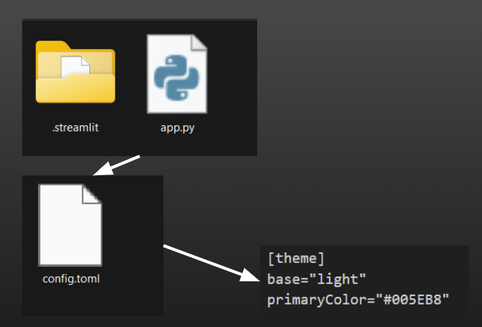
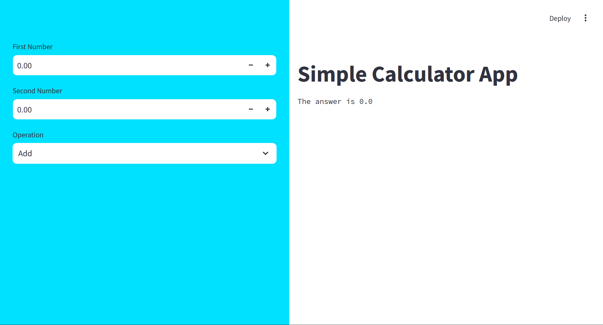

<br>

Streamlit lets us change the look of an app using a configuration file.

This file must be called `config.toml` and lives inside a subfolder called `.streamlit/`.

{.box}

<br>

## Where to put the `.streamlit/` folder

Streamlit looks for `.streamlit/config.toml` in your **working directory**. That is the folder you are in when you run `streamlit run`.

It is not necessarily the folder that contains `app.py`.

<br>

If `app.py` is in the same folder you run the command from, the two sit side-by-side:

```
my_project/
├── .streamlit/
│   └── config.toml
└── app.py
```

```
cd my_project
streamlit run app.py
```

<br>

If `app.py` is in a subfolder, `.streamlit/` goes into the folder you run the command from (often the project root), not next to `app.py`.

```
my_project/
├── .streamlit/
│   └── config.toml
└── src/
    └── app.py
```

```
cd my_project
streamlit run src/app.py
```

If you ran `streamlit run app.py` from inside `src/`, streamlit would look for `src/.streamlit/` instead.

<br>

## Creating a template `config.toml` from streamlit

The `config.toml` file contains a variable number of parameters.

It can determine whether the default colour scheme is light or dark, and whether the default Streamlit colours are overridden.

You can generate a template showing all the available configuration options by running `streamlit config show` in your terminal. You can then copy the relevant settings into your own `.streamlit/config.toml` file.

:::{.callout-tip}
Newer versions of Streamlit have many more theme options than older ones. If an option in this chapter has no effect, check that your Streamlit version is up to date.
:::

<br>

## Example app with custom colours

### `config.toml`

```{toml}
[theme]
base="light"
primaryColor="#005EB8"
secondaryBackgroundColor="#00e0ff"
```

<br>

### `app.py`

```{python}
#| eval: false

import streamlit as st

st.title('Simple Calculator App')

with st.sidebar:
    num_1 = st.number_input(label="First Number")
    num_2 = st.number_input(label="Second Number")
    operator = st.selectbox(label="Operation", options=["Add", "Subtract", "Multiply", "Divide"])

if operator == "Add":
    output = num_1 + num_2
elif operator == "Subtract":
    output = num_1 - num_2
elif operator == "Multiply":
    output = num_1 * num_2
elif operator == "Divide":
    output = num_1 / num_2

st.text(f"The answer is {output}")
```

<br>

### App

{.box}

<br>

## More theme options

The `[theme]` section can do much more than set colours.

| Option | What it does |
|---|---|
| `base` | Starting point: `"light"` or `"dark"` (can also point to an external theme file) |
| `primaryColor` | Accent colour for buttons, sliders, links etc. |
| `backgroundColor` | Main page background |
| `secondaryBackgroundColor` | Background of widgets and the sidebar |
| `textColor` | Main text colour |
| `baseRadius` | Roundness of corners: `"none"`, `"small"`, `"medium"`, `"large"`, `"full"`, or a size in pixels/rem |
| `buttonRadius` | Roundness of buttons specifically (same values as `baseRadius`) |
| `font`, `headingFont`, `codeFont` | Fonts (see the fonts chapter) |
| `baseFontSize`, `baseFontWeight` | Default text size and weight |

There are also options for the colour and visibility of borders around widgets, dataframes and the sidebar.

Here is an example that makes everything more rounded:

```{toml}
[theme]
base="light"
primaryColor="#005EB8"
baseRadius="large"
buttonRadius="full"
```

<br>

## Styling the sidebar separately

The sidebar can have its own theme settings. Put them in a `[theme.sidebar]` section.

```{toml}
[theme]
base="light"
primaryColor="#005EB8"
backgroundColor="#FFFFFF"

[theme.sidebar]
backgroundColor="#E8EDEE"
secondaryBackgroundColor="#FFFFFF"
```

This is useful for giving navigation and input controls a different look to the main page.

<br>

## Light and dark themes together

Streamlit can offer both a light and a dark theme, and users can switch between them from the app's settings menu.

To do this, define the options in separate `[theme.light]` and `[theme.dark]` sections.

```{toml}
[theme.light]
primaryColor="#005EB8"
backgroundColor="#FFFFFF"
secondaryBackgroundColor="#E8EDEE"
textColor="#231F20"

[theme.dark]
primaryColor="#4C9BE8"
backgroundColor="#0B1F33"
secondaryBackgroundColor="#16324F"
textColor="#FFFFFF"
```

Sidebar settings can be given in the same way, using `[theme.light.sidebar]` and `[theme.dark.sidebar]`.

:::{.callout-warning}
A few options, such as `base`, `fontFaces`, `baseFontSize` and `baseFontWeight`, can only be set in the main `[theme]` section, not inside `[theme.light]` or `[theme.dark]`.
:::

:::{.callout-tip}
If you choose your own colours, check there is enough contrast between text and background so that the app is readable for everyone. This matters especially for NHS and public sector tools.
:::
