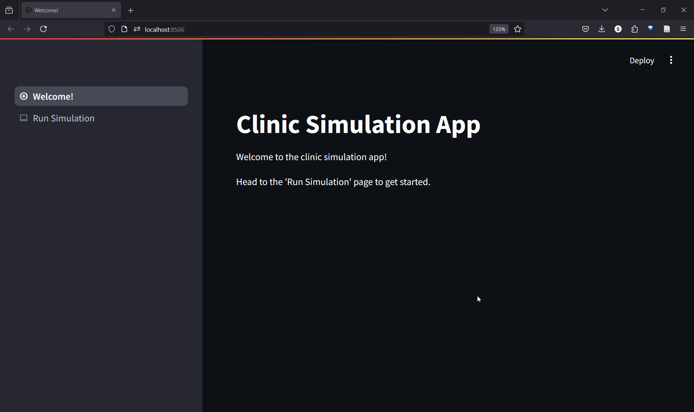

<br>

There are a few parts of Streamlit's theming that we can officially change using a configuration file.

This file must be called `config.toml` and lives inside a subfolder called `.streamlit/`.

{.box}

<br>

## Where to put the `.streamlit/` folder

Streamlit looks for `.streamlit/config.toml` in your **working directory**. That is the folder you are in when you run `streamlit.run`.

It is not necessarily the folder that contains `app.py`.

<br>

If `app.py` is in the same folder you run the command from, the two sit side-by-side:

```
my_project/
├── .streamlit/
│   └── config.toml
└── app.py
```

```
cd my_project
streamlit run app.py
```

<br>

If `app.py` is in a subfolder, `.streamlit/` goes into the folder you run the command from (often the project root), not next to `app.py`.

```
my_project/
├── .streamlit/
│   └── config.toml
└── src/
    └── app.py
```

```
cd my_project
streamlit run src/app.py
```

If you ran `streamlit run app.py` from inside `src/`, streamlit would look for `src/.streamlit/` instead.

<br>

## Creating a template `config.toml` from streamlit

The `config.toml` file contains a variable number of parameters.

It can determine whether the default colourscheme is light or dark, and whether the default streamlit colours are overridden.

You can create a template config.toml from within streamlit, then paste the output into a config.toml file you create yourself.

{.box}

Let's look at an example app.

<br>

## Example app with custom colours

### `config.toml`

```{toml}
[theme]
base="light"
primaryColor="#005EB8"
secondaryBackgroundColor="#00e0ff"
```

<br>

### `app.py`

```{python}
#| eval: false

import streamlit as st

st.title('Simple Calculator App')

num_1 = st.number_input(label="First Number")

num_2 = st.number_input(label="Second Number")

operator = st.selectbox(label="Operation", options=["Add", "Subtract", "Multiply", "Divide"])

if operator == "Add":
    output = num_1 + num_2
elif operator == "Subtract":
    output = num_1 - num_2
elif operator == "Multiply":
    output = num_1 * num_2
elif operator == "Divide":
    output = num_1 / num_2

st.text(f"The answer is {output}")

```

<br>

### App

{.box}
