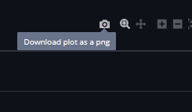

<br>

Users may often want to download Streamlit outputs - for example, the data behind a graph, a summary CSV, or images like graphs and word clouds.

This chapter focuses on downloading **tabular** data, as you would display in an Excel file or pandas dataframe. We'll assume your data is in a pandas dataframe (or if not, you can easily to convert into one from a numpy array, for example).

Let's start with an app that loads a dataset on the popularity of names, does some manipulation, and returns the most frequent names.

<br>

## Using the integrated download option

If a dataframe is displayed using the standard `st.dataframe()` command or the `st.write()` command, a csv download option will become visible when hovering over the dataframe.

```{python}
#| eval: false
import streamlit as st
import pandas as pd

url = 'https://files.catbox.moe/eor4ta.csv'
name_lookup_df = pd.read_csv(url).melt(id_vars=["Name", "Gender"]).dropna().rename(
    columns={"variable": "Year", "value": "Rank"}
    )

names_appearing_most_years = pd.DataFrame(name_lookup_df['Name'].value_counts())

st.dataframe(names_appearing_most_years)
```

```{stlite-python}
import streamlit as st
import pandas as pd

url = 'https://files.catbox.moe/eor4ta.csv'
name_lookup_df = pd.read_csv(url).melt(id_vars=["Name", "Gender"]).dropna().rename(
    columns={"variable": "Year", "value": "Rank"}
    )

names_appearing_most_years = pd.DataFrame(name_lookup_df['Name'].value_counts())

st.dataframe(names_appearing_most_years)
```

<br>

## Adding download buttons

However, often we may only be displaying a graph of the data rather than displaying the data as well, or we may want to provide downloads of data files slightly different to the ones we are displaying - for example, ones with more or less columns, or providing the raw data instad of the summarised data we are displaying.

When this is the case, we can instead provide download buttons to allow any python dataframe in our app's running environment to be downloaded.

This is also just a bit more visible than the default .csv download button in streamlit dataframes, which is easy for your end users to miss.

The function we will use is `st.download_button`.

This uses the standard format

```{python}
#| eval: false

st.download_button(
   "Click here to download the dataframe as a csv file", # <1>
   data=individual_df.to_csv(index=False).encode('utf-8'), # <2>
   file_name=f"{input_name}_historical_popularity.csv", # <3>
   mime="text/csv" # <4>
   )
```

1. Provide a label for the file uploader to prompt the user
2. Pass in the data file to download here
3. Pass in a default filename that ends with the file type of the file that is being downloaded
4. The MIME type of the data (don't worry too much about what this is - just use the value given in the examples below or leave this parameter out entirely to accept the default)

<br>

## Download button - CSV files

CSV files are relatively simple to provide a download for.

The key steps are

- use the `.to_csv()` method on the dataframe without providing an output filepath
- encode this object as `utf-8` using the `.encode()` method
- pass the output of this code to the download button as the `data` parameter
- (OPTIONAL) provide a default file name for the resulting csv - you may want to use an f-string to intelligently provide a filename if the data is reflecting options the user has chosen
- (OPTIONAL) Specify the MIME type of the data as `"text/csv"` - an automatic value will be inferred from the data type, but it is better practice to more explicitly specify it like this

```{python}
#| eval: false
import streamlit as st
import pandas as pd
import plotly.express as px

######################################
# This section just deals with
# loading in and using the dataframe
######################################

url = 'https://files.catbox.moe/eor4ta.csv'
name_lookup_df = pd.read_csv(url)

name_lookup_df = name_lookup_df.melt(id_vars=["Name", "Gender"]).dropna().rename(
    columns={"variable": "Year", "value": "Rank"}
    )

name_lookup_df['Year'] = name_lookup_df['Year'].astype('int64')
name_lookup_df['Rank'] = name_lookup_df['Rank'].astype('int64')

input_name = st.text_input("What name would you like to lookup?", value="Daniel")

individual_df = name_lookup_df[name_lookup_df['Name'] == input_name]

if input_name is not None:

    st.plotly_chart(
        px.line(individual_df,
                y="Rank", x="Year", color="Gender",
                range_y=[1000, 0], range_x=[1920, 2022],
                markers=True)
                )

######################################
# This deals with adding the download
# button and gettng the dataframe into
# the correct format for downloading
######################################

st.download_button(
   "Click here to download the dataframe as a csv file",
   data=individual_df.to_csv(index=False).encode('utf-8'),
   file_name=f"{input_name}_historical_popularity.csv",
   mime="text/csv"
   )

```

```{stlite-python}
import micropip
await micropip.install("plotly")

import streamlit as st
import pandas as pd
from plotly import express as px

url = 'https://files.catbox.moe/eor4ta.csv'
name_lookup_df = pd.read_csv(url)

name_lookup_df = name_lookup_df.melt(id_vars=["Name", "Gender"]).dropna().rename(
    columns={"variable": "Year", "value": "Rank"}
    )

name_lookup_df['Year'] = name_lookup_df['Year'].astype('int64')
name_lookup_df['Rank'] = name_lookup_df['Rank'].astype('int64')

input_name = st.text_input("What name would you like to lookup?", value="Daniel")

individual_df = name_lookup_df[name_lookup_df['Name'] == input_name]

if input_name is not None:

    st.plotly_chart(
        px.line(individual_df,
                y="Rank", x="Year", color="Gender",
                range_y=[1000, 0], range_x=[1920, 2022],
                markers=True)
                )

st.download_button(
   "Click here to download the dataframe as a csv file",
   individual_df.to_csv(index=False).encode('utf-8'),
   f"{input_name}_historical_popularity.csv",
   "text/csv"
)
```

:::{.callout-tip}
When using plotly, users can hover over the plot and choose 'Download plot as a png'.

{.box}
:::

<br>

## Download button - excel files

It is slightly more complex to set up the download of a dataframe as an Excel file.

However, this does have the benefit of being something your end users will be more familiar with - and with advanced usage of the `xlsxwriter` library, it allows us to add in multiple worksheets to a single file, as well as more advanced things like formulas and Excel charts that will update if users update values in the spreadsheet.

```{python}
#| eval: false
import streamlit as st
import pandas as pd
import plotly.express as px
import xlsxwriter # ADDITIONAL LOAD
from io import BytesIO # ADDITIONAL LOAD

######################################
# This section just deals with
# loading in and using the dataframe
######################################

url = 'https://files.catbox.moe/eor4ta.csv'
name_lookup_df = pd.read_csv(url)

name_lookup_df = name_lookup_df.melt(id_vars=["Name", "Gender"]).dropna().rename(
    columns={"variable": "Year", "value": "Rank"}
    )

name_lookup_df['Year'] = name_lookup_df['Year'].astype('int64')
name_lookup_df['Rank'] = name_lookup_df['Rank'].astype('int64')

input_name = st.text_input("What name would you like to lookup?", value="Daniel")

individual_df = name_lookup_df[name_lookup_df['Name'] == input_name]

if input_name is not None:

    st.plotly_chart(
        px.line(individual_df,
                y="Rank", x="Year", color="Gender",
                range_y=[1000, 0], range_x=[1920, 2022],
                markers=True)
                )

######################################
# This deals with adding the download
# button and gettng the dataframe into
# the correct format for downloading
######################################

output = BytesIO()

writer = pd.ExcelWriter(output, engine='xlsxwriter')

individual_df.to_excel(writer, sheet_name=f"{input_name} Data", index=False)
name_lookup_df.to_excel(writer, sheet_name=f"Full Data", index=False)

writer.close()

st.download_button(
   "Click here to download the dataframe as an Excel file",
   data = output.getvalue(),
   file_name=f"{input_name}_historical_popularity.xlsx",
   mime="application/vnd.ms-excel"
)
```

```{stlite-python}
import micropip
await micropip.install("plotly")
await micropip.install("xlsxwriter")

import streamlit as st
import pandas as pd
from plotly import express as px
import xlsxwriter
from io import BytesIO

url = 'https://files.catbox.moe/eor4ta.csv'
name_lookup_df = pd.read_csv(url)

name_lookup_df = name_lookup_df.melt(id_vars=["Name", "Gender"]).dropna().rename(
    columns={"variable": "Year", "value": "Rank"}
    )

name_lookup_df['Year'] = name_lookup_df['Year'].astype('int64')
name_lookup_df['Rank'] = name_lookup_df['Rank'].astype('int64')

input_name = st.text_input("What name would you like to lookup?", value="Daniel")

individual_df = name_lookup_df[name_lookup_df['Name'] == input_name]

if input_name is not None:

    st.plotly_chart(
        px.line(individual_df,
                y="Rank", x="Year", color="Gender",
                range_y=[1000, 0], range_x=[1920, 2022],
                markers=True)
                )

output = BytesIO()

writer = pd.ExcelWriter(output, engine='xlsxwriter')

individual_df.to_excel(writer, sheet_name=f"{input_name} Data", index=False)
name_lookup_df.to_excel(writer, sheet_name=f"Full Data", index=False)

writer.close()

st.download_button(
   "Click here to download the dataframe as an Excel file",
   data = output.getvalue(),
   file_name=f"{input_name}_historical_popularity.xlsx",
   mime="application/vnd.ms-excel"
)
```
