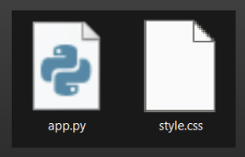
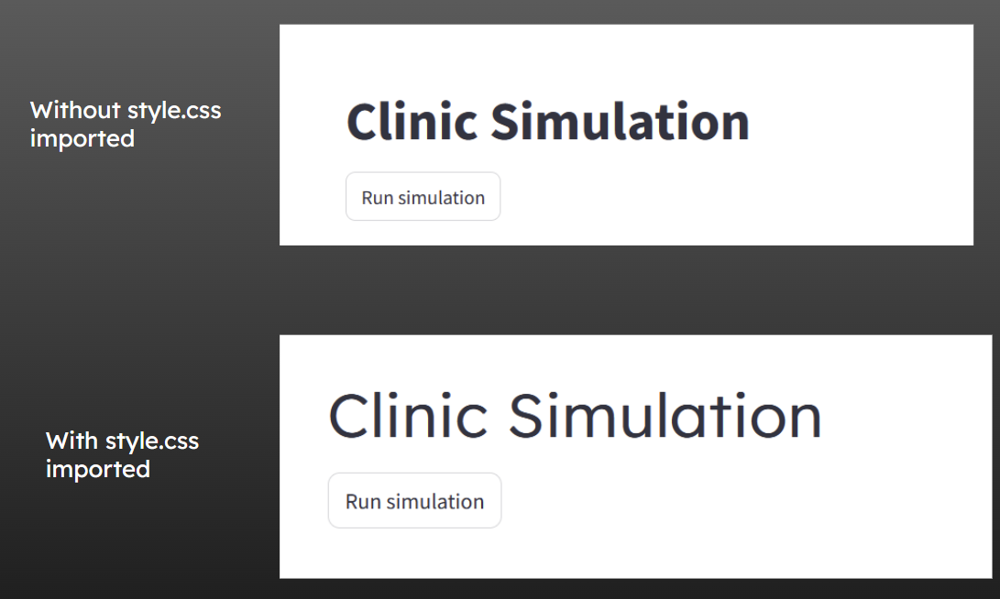

<br>

There are two ways to change the fonts in your app:

1. **Theme options in `config.toml`** (recommended where available)
2. **Custom CSS** (more flexible, but more fragile)

<br>

## Fonts in `config.toml`

Recent versions of Streamlit can change fonts directly from the `[theme]` section of your `config.toml` file (see the app colours chapter for where this file lives).

This is more reliable than CSS, because it doesn't depend on Streamlit's internal class names, which change between versions.

<br>

### Built-in font choices

You can set three fonts separately:

| Option | What it changes |
|---|---|
| `font` | Main body text |
| `headingFont` | Headings |
| `codeFont` | Code and monospaced text |

Each accepts `"sans-serif"` (Source Sans, the default), `"serif"` (Source Serif) or `"monospace"` (Source Code).

```{toml}
[theme]
font="serif"
headingFont="sans-serif"
codeFont="monospace"
```

The sidebar can have its own fonts too, using a `[theme.sidebar]` section.

<br>

### Size and weight

```{toml}
[theme]
baseFontSize=18
baseFontWeight=300
```

`baseFontWeight` uses multiples of 50 between 100 and 600.

You can also set sizes and weights for individual heading levels (h1 to h6) using `headingFontSizes` and `headingFontWeights`.

<br>

### Using a Google font

Streamlit can load a font from a CSS URL, such as a Google Fonts link. The format is the font name, a colon, then the URL.

```{toml}
[theme]
font="Lexend:[https://fonts.googleapis.com/css2?family=Lexend:wght@200&display=swap](https://fonts.googleapis.com/css2?family=Lexend:wght@200&display=swap)"
baseFontWeight=200
```

:::{.callout-tip}
Google Fonts provide a good option that is easy to load in. You can explore the wide range of fonts offered here:

<https://fonts.google.com/>

**Istok Web** is often cited as being the closest Google Font equivalent to the standard NHS font *Frutiger*.

```{toml}
[theme]
font="Lexend:https://fonts.googleapis.com/css2?family=Lexend:wght@200&display=swap"

```
:::

<br>

### Using your own font files

If you have the font files (for example `.woff2` or `.ttf`), you can host them with your app instead of loading them from the internet. This is helpful if your app needs to work offline or on restricted networks.

1. Put the font files in a folder called `static/` next to your app.
2. Turn on static file serving in `config.toml`.
3. Declare the font with `[[theme.fontFaces]]`.

```{toml}
[server]
enableStaticServing = true

[[theme.fontFaces]]
family = "MyFont"
url = "app/static/MyFont-Regular.woff2"
weight = 400

[[theme.fontFaces]]
family = "MyFont"
url = "app/static/MyFont-Bold.woff2"
weight = 700

[theme]
font = "MyFont"
```

:::{.callout-note}
Static file serving needs a reasonably recent version of Streamlit (the official tutorial lists 1.45.0 or later). Font options in the `[theme]` section only work on versions that support them.
:::

:::{.callout-warning}
`fontFaces` can only be set in the main `[theme]` section, not inside `[theme.light]` or `[theme.dark]`.
:::

<br>

## Fonts with custom CSS

Config options cover fonts, sizes and weights. To customise the look of your app beyond that, we can use custom CSS.

CSS stands for "cascading style sheets" and is a language used for theming much of the web!

We can create our own `.css` file and force Streamlit to load it in.

{.box}

<br>

### Loading the css file

To load the file into the app, we need to include the following command:

```{python}
#| eval: false
with open("style.css") as css:
    st.markdown(f'<style>{css.read()}</style>', unsafe_allow_html=True)
```

This points towards the css file and wrapss it in some HTML tags that will ensure the css is recognised by the web browser.

<br>

### Example font styling from css

The css file can contain any valid css, but we are interested in this chapter in targeting fonts specifically.

To begin with, we load in a font from the Google font families.

We then choose some areas of this app to apply it to.

`h1, h2, h3, h4, p` will target all headers and the main body text in the app.

More advanced or Streamlit-specific elements may be harder to target.

```{css}
@import url('https://fonts.googleapis.com/css2?family=Lexend:wght@200&display=swap');

html, body, st-emotion-cache [class*="css"] {
    font-family: 'Lexend', sans-serif;
    font-size: 18px;
    font-weight: 200;
    color: #091747;
}

h1, h2, h3, h4, p {
	font-family: "Lexend", sans-serif;
}
```

:::{.callout-tip}

You can right click when running your app and choose 'inspect' to get an idea of the possible tags to target with your custom CSS.

The streamlit forums and StackOverflow are also good ways to find examples of people applying custom theming to similar things to what you are looking to do.

:::

Here is an example of a Streamlit title with and without the custom theming applied.

{.box}

:::{.callout-tip}
To apply Istok Web with CSS, you would use:

```{css}
@import url('https://fonts.googleapis.com/css2?family=Istok+Web:wght@200&display=swap');

html, body, st-emotion-cache [class*="css"] {
    font-family: 'Istok Web', sans-serif;
    font-size: 18px;
    font-weight: 200;
    color: #091747;
}

h1, h2, h3, h4, p {
	font-family: "Istok Web", sans-serif;
}
```
:::
