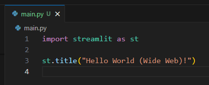
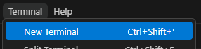
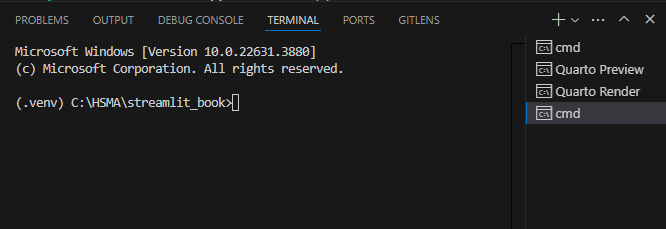
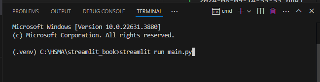
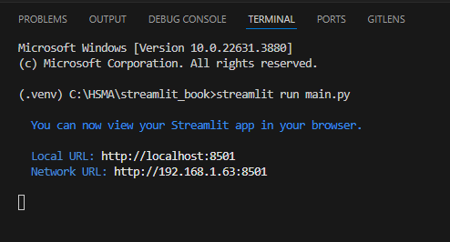
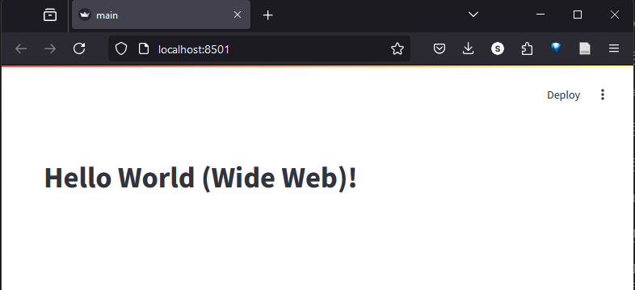
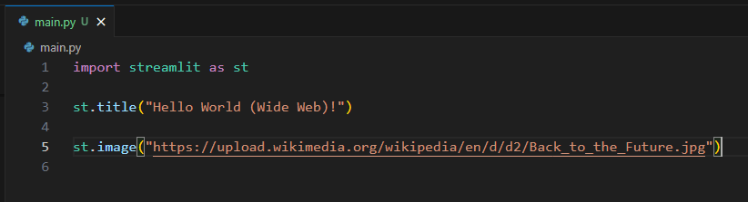
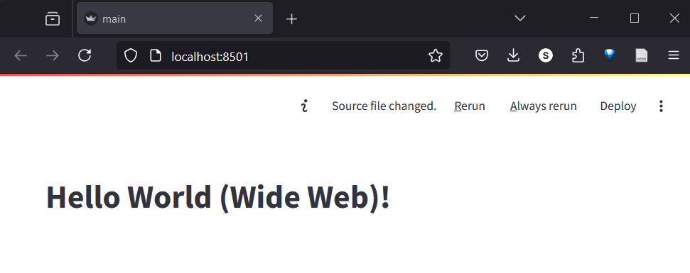
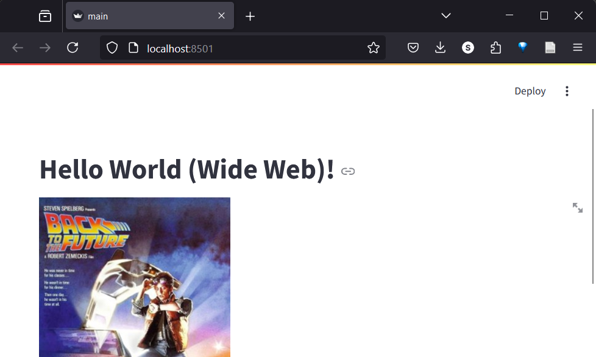

<br>

Streamlit apps are remarkably simple to initialise!

Let's create a web app that just has a heading.

```{python}
#| eval: false
#| echo: true
import streamlit as st

st.title("Hello World (Wide Web)!")
```

```{stlite-python}
import streamlit as st

st.title("Hello World (Wide Web)!")
```

This is all you need to create your very first Streamlit app!

Streamlit takes care of everything else behind the scenes - you can focus primarily on the Python code for the things you want to do in your app, and Streamlit does the hard work of making it display and passing the inputs from the user to and fro in the way the web expects.

<br>

## Previewing your app

When you are writing streamlit apps from within your IDE - such as vscode - you will need to run some extra code to preview your app.

First, you must make sure you save your app!

Let's save our app as `main.py`.

{.box}

Then we need to open a terminal.

{.box}

{.box}

In the terminal, we then run the command `streamlit run main.py`

{.box}

This will spin up a temporary server to run your app from.

{.box}

Your app will then automatically open in a browser window in your default browser.

{.box}

<br>

## Updating your app

If we change and save our source file, like so...

{.box}

Our running app will recognise that there has been a change and give us the option to rerun to incorporate the new change without having to close and restart our temporary server.

This is really handy as it allows us to rapdily tweak and iterate our Streamlit apps!

{.box}

You can also just use the refresh button in your browser if you would prefer.

{.box}

The 'always rerun' option will mean that changes made to your source file will automatically trigger a rerun/refresh without you having to do it manually - it's up to you if that's something you'd prefer.
