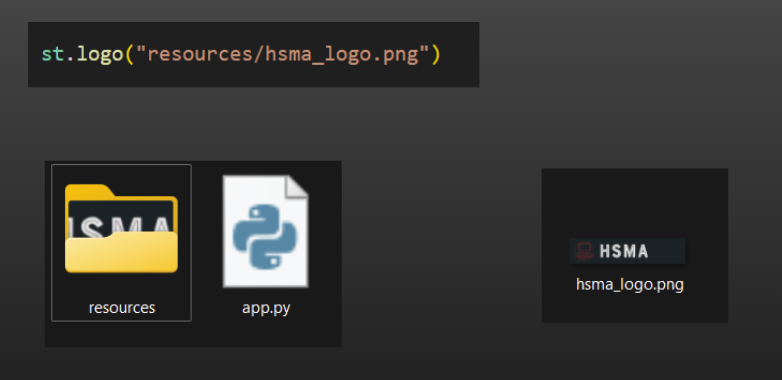
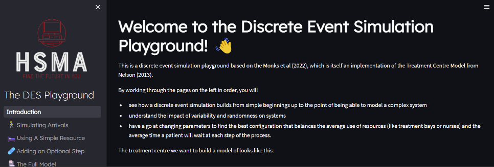

<br>

## Logos

Streamlit has built-in support for logos in your app.

You give it the path to an image file. In the example below, it looks for a folder called 'resources' and then the 'hsma_logo.png' file inside it.

{.box}

The logo will appear in the top left of your app. If it's a multi page app or an app using a Streamlit sidebar that you have manually defined, it will appear at the top of the sidebar.

:::{.callout-tip}
The command to insert a logo is

`st.logo("your_filepath_here")`

e.g. `st.logo("resources/hsma_logo.png")`
:::

:::{.callout-note}
Relative paths are usually resolved from the folder you run `streamlit run` in, not from the folder containing your script. If your logo doesn't appear, check this first.
:::

```{python}
#| eval: false
import streamlit as st

st.logo("resources/hsma_logo.png")

st.title('Simple Calculator App')

with st.sidebar:
  num_1 = st.number_input(label="First Number")
  num_2 = st.number_input(label="Second Number")
  operator = st.selectbox(label="Operation", options=["Add", "Subtract", "Multiply", "Divide"])

if operator == "Add":
    output = num_1 + num_2
elif operator == "Subtract":
    output = num_1 - num_2
elif operator == "Multiply":
    output = num_1 * num_2
elif operator == "Divide":
    output = num_1 / num_2

st.text(f"The answer is {output}")

```

<br>

## Choosing a logo size

By default, logos have a maximum height of 24 pixels. You can change this with the `size` argument:

| `size` | Maximum height |
| - | - |
| `"small"` | 20 pixels |
| `"medium"` (default) | 24 pixels |
| `"large"` | 32 pixels |

The width scales automatically to fit the sidebar.

```{python}
#| eval: false
st.logo("resources/hsma_logo.png", size="large")
```

:::{.callout-tip}
For the most consistent results:

- call `st.logo` early in your script
- choose an image that looks good in both light and dark mode
- avoid empty margins (transparent padding) around the image, as they make the logo look smaller than it is
:::

<br>

## Larger logos

If `size="large"` still isn't big enough, it is possible to go further with custom CSS, but this is fragile and may break as Streamlit changes.

{.box}

The approach requires using some markdown to inject some custom CSS (see the fonts chapter for more details on CSS).

```{python}
#| eval: false
import streamlit as st

st.logo("resources/hsma_logo.png")

st.markdown(
    """
    <style>
        [data-testid="stSidebarHeader"] {
            height: auto !important;
            padding-bottom: 1rem;
        }
        [data-testid="stSidebarHeader"] img,
        img[data-testid="stLogo"] {
            height: 200px !important;
            max-height: none !important;
            width: auto !important;
            max-width: 100% !important;
        }
    </style>
    """,
    unsafe_allow_html=True,
)
```

<br>

## Making the logo a link

Use the `link` argument to make the logo clickable. The URL must start with `http://` or `https://`.

```{python}
#| eval: false
st.logo(
    "resources/hsma_logo.png",
    link="[https://hsma.co.uk](https://hsma.co.uk)"
)
```

<br>

## A different logo when the sidebar is collapsed

When the sidebar is collapsed, Streamlit shows a smaller logo in the header. You can provide a separate, compact image for this with `icon_image`. This works well with a wide logo in the sidebar and a square icon version for the header.

```{python}
#| eval: false
st.logo(
    "resources/hsma_logo.png",
    icon_image="resources/hsma_icon.png",
)
```
