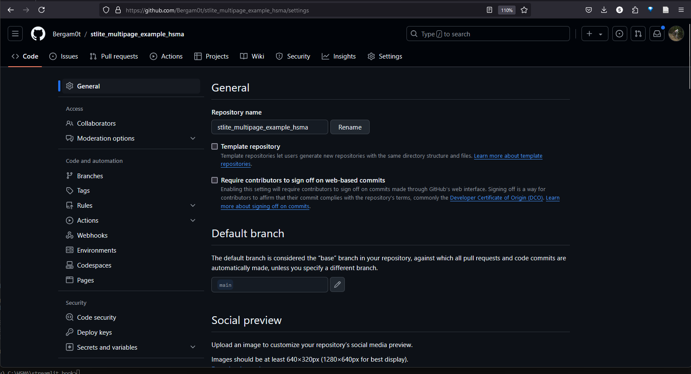
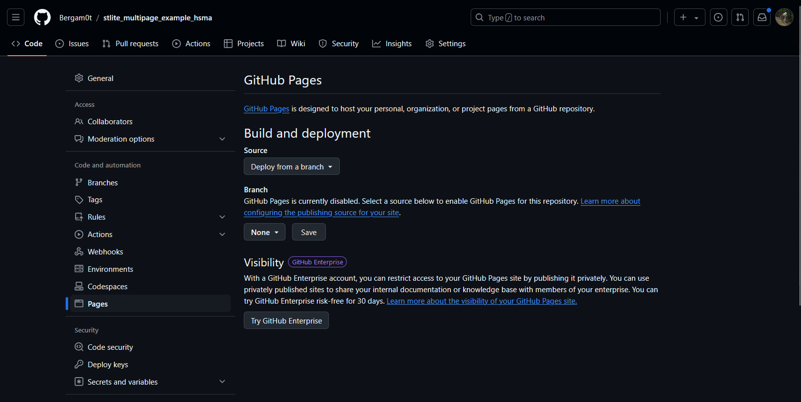
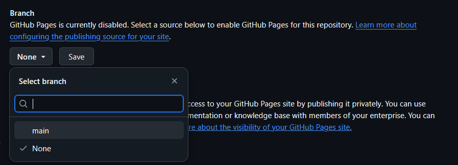
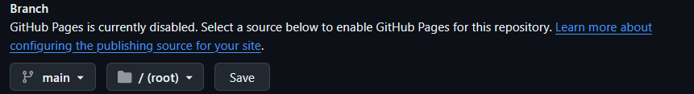
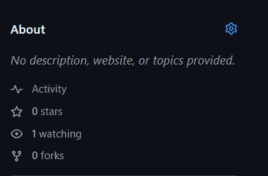
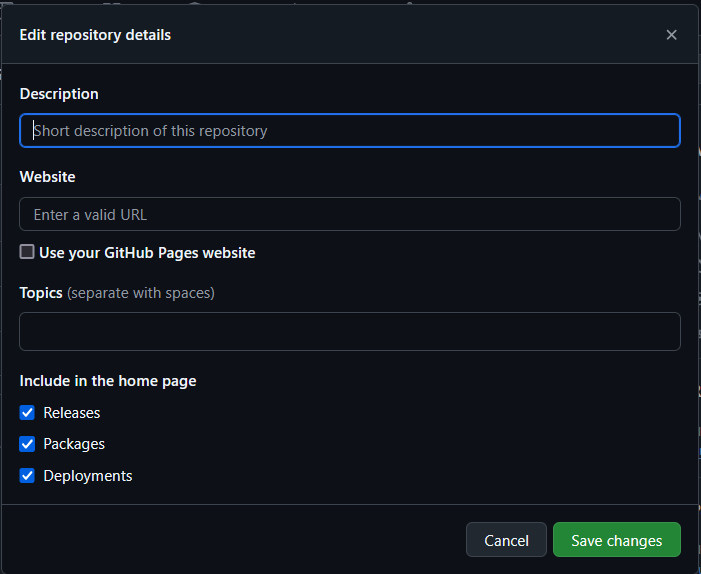
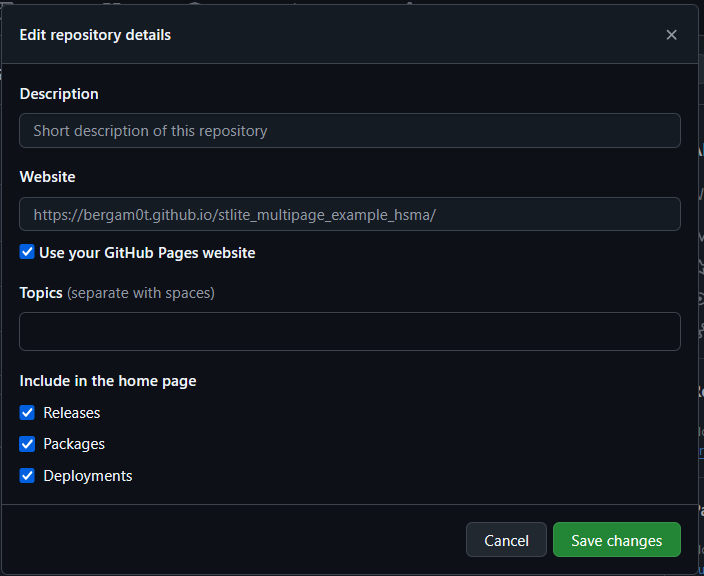
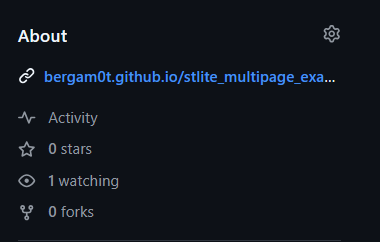

<br>

## stlite

[stlite](https://github.com/whitphx/stlite) runs Python directly in the user's browser. Instead of sending requests to a server to run your code, the user's own device does the work.

### How does stlite work?

1. A browser can display your app, but can't normally run its Python code. Browsers usually use **JavaScript**, a programming language designed for web pages.

2. In 2017, **WebAssembly (Wasm)** was released. It lets browsers run compiled code alongside JavaScript, including software they wouldn't normally support.

3. **Pyodide** uses WebAssembly to provide a Python environment. It includes an interpreter (which reads and runs Python code) and support for packages.

4. stlite uses this environment to run your Streamlit app on the user's device.

While some kind of hosting is still required to allow the website code to be served, the hosting requirements are significantly smaller as the host server does not need to actually run any processes itself, and simply acts as a distributor of the code files.

<br>

## Pros and cons

**Pros**

- lighter requirements for the machine hosting the files
  - it is also possible to serve the files from free hosting such as Github Pages
- data not leaving the user's machine
- no limitations on the number of concurrent users, making it suitable for apps with multiple users likely to be making use of the app at once

:::{.callout-warning}
While stlite code in theory avoids data leaving the user's browser, the limitations and security have not fully yet been investigated by the HSMA team in the context of sensitive data, so it should not be used for sensitive data until further assurances can be given.
:::

**Cons**

- some limitations on the Python packages that are available
    - many key packages including pandas, geopandas, plotly and simpy are available
- slower running of code (between 3x and 20x slower)
  - execution speed is linked to the speed of the user's device, so using devices like phones will give significantly poorer performance
- slower initial startup of the app
- apps using older versions of stlite don't work on the Firefox browser
- possibility of Pyodide being blocked by organisational policies in the future (though this does not seem to occur at present)

<br>

## Running a Streamlit app with stlite

To use stlite, add an `index.html` file to your app folder. HTML defines the structure and content of a web page. This file loads stlite and tells it how to launch your app. You can reuse a standard template and change a few details.

```{.html}

```

### Parts that stay the same

The standard page structure can stay the same between apps:

- `<head>` contains page settings and loads stlite's stylesheet and JavaScript.
- `<body>` contains the page content, including your app.

The closing tags at the end mark where the app, page body and HTML document finish.

These lines are pinned to a particular stlite version, `@stlite/browser@1.12.2`. stlite recommend pinning because their API may change without backwards compatibility in future releases. If a newer version has been released, you may wish to upgrade. See the [stlite releases](https://github.com/whitphx/stlite/releases).

:::{.callout-warning}
Pinning stlite protects you from breaking changes in new releases, but it doesn't guarantee an old version will keep working indefinitely. An app built on an older release can stop working over time. Test your deployed app periodically, and when it breaks, try upgrading to a recent stlite version and re-testing.
:::

**Parts that stay the same:**

```{.html source-line-numbers="1-5,7-10,20-21"}

```

### Parts to amend for your app

- `<title>` sets the browser tab's initial title. The app replaces it once it loads, so it only appears briefly.
- `<streamlit-app>` specifies the entrypoint file.
- `<app-file>` identifies all other files the app needs, including Python files, images and other file types.
- `<app-requirements>` lists the Python packages to install.

In our example we pin `simpy` and `sim-tools` to the versions used to develop the app. We leave `numpy` and `pandas` unpinned so Pyodide can use its compatible versions. We don't include `streamlit`, as stlite provides it.

**Parts to amend for your app:**

```{.html source-line-numbers="6,11-19"}

```

<br>

## Multipage stlite apps

Multipage stlite apps are set up in the same way! You just have to include each page using `<app-file>`. For example:

```{.html source-line-numbers="12,14-15"}

```

<br>

## Trying the app locally

`index.html` serves as the website's starting page. To view the app locally, open a terminal in the folder containing `index.html` and run:

```bash
python -m http.server 8000
```

Then open `http://localhost:8000` in your browser.

To share it through a web address, you need to host the files online. GitHub Pages can host `index.html` and the other files your app needs. When someone visits the site, their browser downloads these files and runs the app using stlite.

<br>

## Hosting on GitHub Pages

GitHub Pages is a website hosting service. It takes HTML, CSS and JavaScript files from your GitHub repository and publishes them as a website. It is **free** with public repositories and **easy** to set up because it integrates directly with your repository.

From your GitHub repository, click on 'Settings'.

{.box}

In the sidebar on the left, click on 'pages'.

{.box}

Choose 'Branch' and 'Main'.

{.box}

Leave the folder as 'root' and click 'Save'.

{.box}

After saving, it should look like this:

{.box}

Next, head back to your repository and click on the cog next to 'about'.

{.box}

Tick 'use your github pages website'.

{.box}

This will automatically generate a github pages link.

{.box}

Click 'Save Changes'

Now click on the URL to view your app.

{.box}

:::{.callout-warning}
Pages deployed with stlite do not work on Firefox (as of September 2024)

Chrome, Edge and Safari are all known to work fine.
:::

<br>

### File locations

These instructions assume your app files are in the repository root, which is why we selected `/ (root)`.

```text
your-repository/
├── index.html
├── app.py
├── home.py
├── model.py
├── simulation.py
├── results.py
└── images/
    └── logo.png
```

You can also organise app files into subfolders. If `index.html` stays in the root, the GitHub Pages settings stay the same. Just update the paths in `index.html`.

```text
your-repository/
├── index.html
└── app/
    ├── app.py
    ├── home.py
    ├── model.py
    ├── simulation.py
    ├── results.py
    └── images/
        └── logo.png
```

If you move `index.html` into a subfolder too, you have a few options:

| Location | What to do |
| - | --- |
| `docs/index.html` | Select `main` → `/docs` as the publishing source. |
| `app/index.html` | Publish the repository root and access the app at `https://USERNAME.github.io/REPOSITORY/app/`. |
| `app/index.html` | Use a GitHub Actions workflow to publish the contents of `app/`. |

For simplicity, we recommend keeping `index.html` in the repository root. The other files can be in subfolders, as long as the paths in `index.html` match.

<br>

## Streamlit versions in stlite

stlite includes a modified version of Streamlit, adapted to run in the browser. This is why we do not add `streamlit` to `<app-requirements>`.

The stlite developers periodically update this version to the latest version of Streamlit, but may not always be up-to-date. New Streamlit features may therefore not be available immediately in stlite. Check the [stlite release notes](https://github.com/whitphx/stlite/releases), and test your app before upgrading.

**Each stlite release is pinned to a particular version of streamlit**. For example, stlite `1.12.2` includes a build based on Streamlit `1.65.0`.

### Find streamlit version in use via GitHub

1. Open the [stlite release you are using on GitHub](https://github.com/whitphx/stlite/tree/%40stlite/browser%401.12.2).
2. Click the `streamlit` submodule link (e.g., `streamlit @ 9c524f4`). This opens the exact Streamlit source code included in that release.
3. Open `lib/pyproject.toml` and find `version` under `[project]`.

### Find streamlit version in use via app

Alternatively, run your app using your chosen stlite version and include this command to see which Streamlit build it uses:

```{.python}
st.write("Streamlit version:", st.__version__)
```

<br>

## Using `st.spinner` in older versions of stlite

::: {.callout-note collapse="true" title="View problem & solution"}

In older versions of stlite, `st.spinner` may not display. This is a problem for long calculations triggered by a click, as users can't tell anything is happening. Add `import asyncio` and yield briefly inside the spinner:

```python
with st.spinner("Running a long-running calculation.."):
    await asyncio.sleep(0.1)

    # Do the actual calculation...
```

:::

