<br>

Streamlit Community Cloud allows you to deploy an unlimited number of web apps for free when your app is uploaded to github.

:::{.callout-tip}

You can host an **unlimited** number of apps when they are hosted in **public** Github repositories or made publicly available, even if the code is private.

You can host **one** app that is not publicly available; however, note that this will still make use of Streamlit's server's, which are located in the USA, so are not suitable for sensitive data.

Each individual app will have limits on the amount of memory, which in turn impacts the number of concurrent (simultaneous) users, though it's difficult to put an exact number on how many concurrent users can be supported for an app given how different each app is in terms of memory requirements.

:::

<br>

## Method 1 - from the app

Before undertaking this step, you will need to have uploaded your repository to Github.

You also need to provide a `requirements.txt` file. Although Streamlit has some common packages by default, we need the file for any non-standard Python packages.

:::{.callout-note collapse="true"}
#### Click here to copy an example `requirements.txt` file
```
pandas==2.2.2
numpy==1.26.4
simpy==4.0.2
matplotlib==3.9.1.post1
plotly==5.23.0
streamlit==1.37.0
streamlit_folium==0.22.0
folium==0.17.0
geopandas==1.0.1
palmerpenguins==0.1.4
ipykernel==6.29.5
ipython==8.27.0
wordcloud==1.9.3
openpyxl
nbformat>=4.2.0
fiona==1.9.0
```
:::

<br>

Now, we will first run the app as normal from the terminal in VSCode.

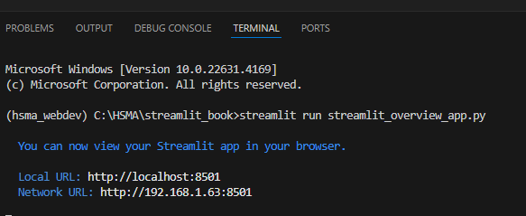{.box}

At the top right of the app, there will be a 'deploy' button. Click on this.

{.box}

In the pop-up that appears, click on the 'deploy now' button for the option on the left.

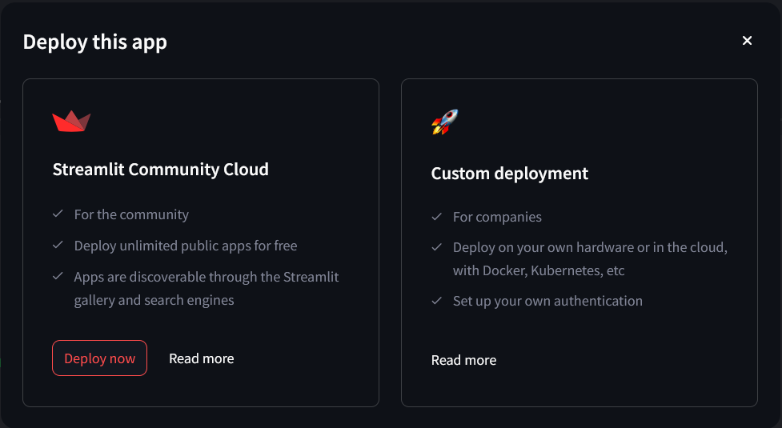{.box}

:::{.callout-tip}
If you have not previously followed this process, you will be asked to authorize Streamlit to link with your Github account.
:::

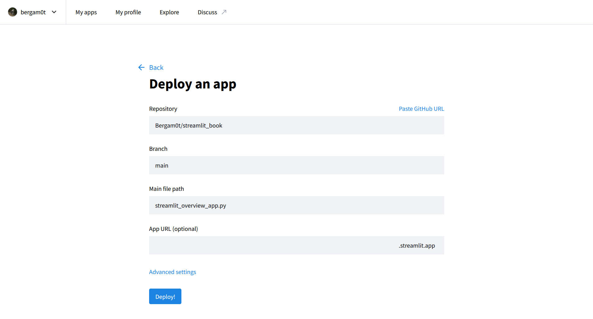{.box}

You should not need to change the values for 'Repository', 'Branch' or 'Main File Path'.

:::{.callout-note}
If your app is in a subfolder, you may need to change the slashes that
:::

Enter an App URL if you don't want to use an autogenerated Streamlit one. This can contain letters, numbers and hyphens.

Next, click on 'Advanced settings'.

Choose the appropriate Python version from the dropdown.

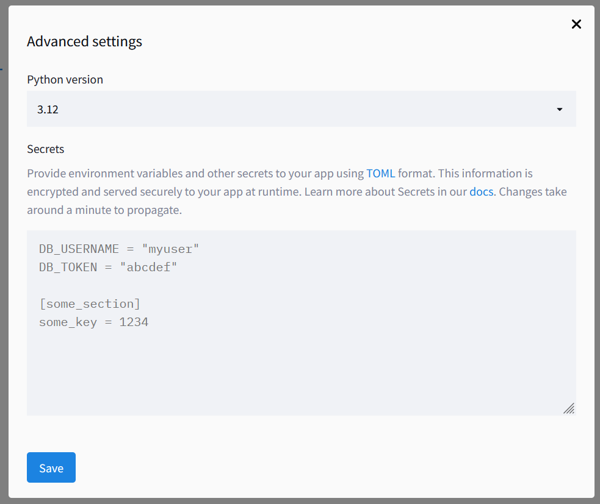{.box}

You don't need to worry about the Secrets file for now.

Click 'Save'.

Now you should be back on the original screen, and can click 'Deploy'.

{.box}


:::{.callout-tip}
#### Animated overview of the process
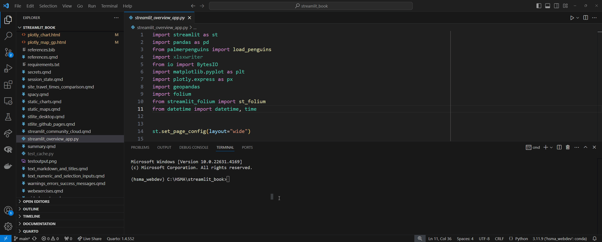{.box}
:::

<br>

## Method 2 - from the Streamlit Community Cloud website

For subsequent apps, you may find it quicker to navigate to <https://share.streamlit.io/> and choose 'Create App'.

:::{.callout-tip}
You will first need to log into Streamlit community cloud using your Github account.
:::

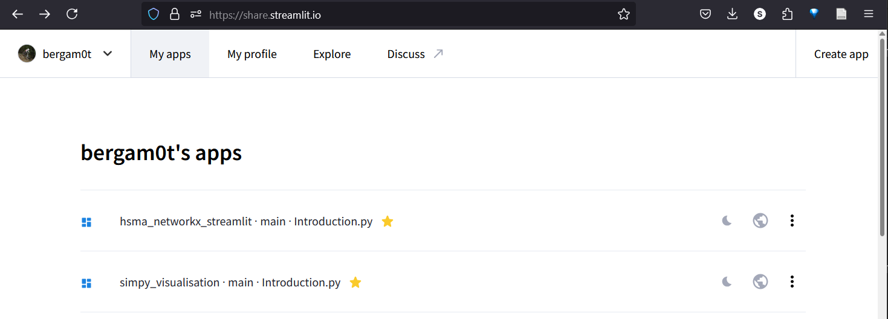{.box}

Choose 'Yup, I have an app'.

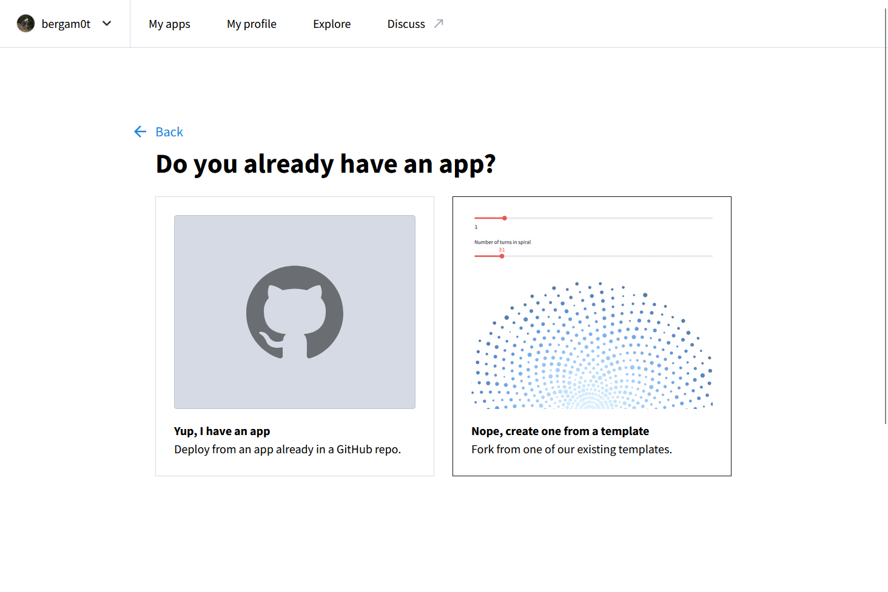{.box}

Fill in the required details.

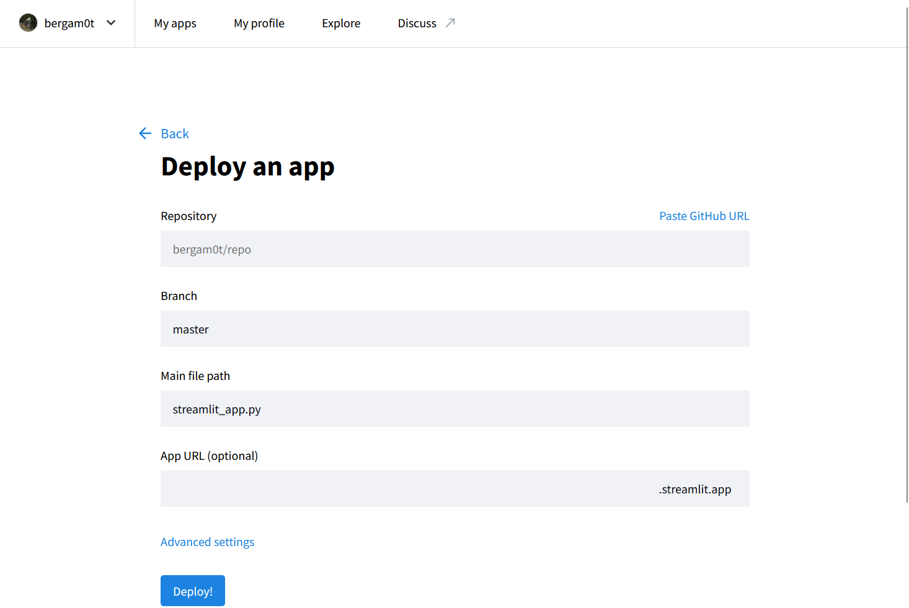{.box}

Clicking on the 'repository' field will give you a scrollable list of all repositories available in your Github.

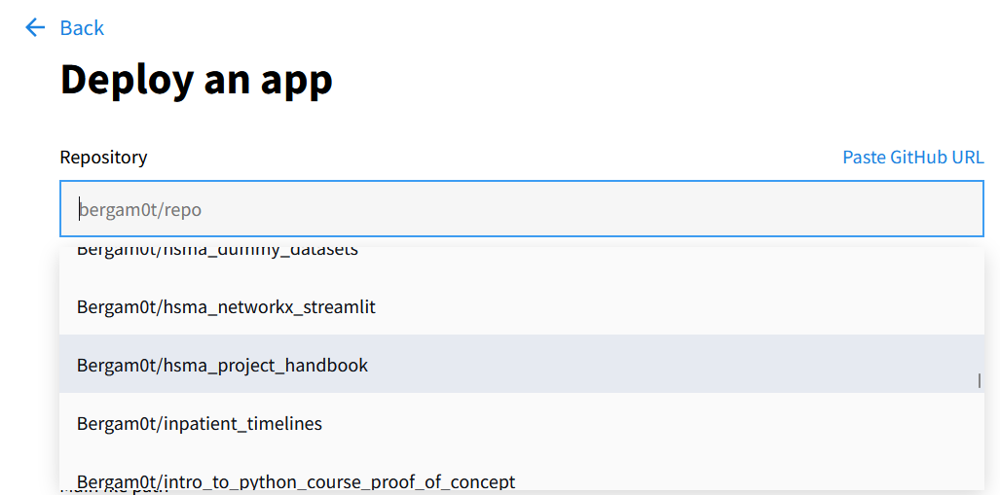{.box}

When you're ready, click deploy.

<br>

## Managing your community cloud apps

Navigating to <https://share.streamlit.io/> will give you an overview of the apps you have published to the community cloud.

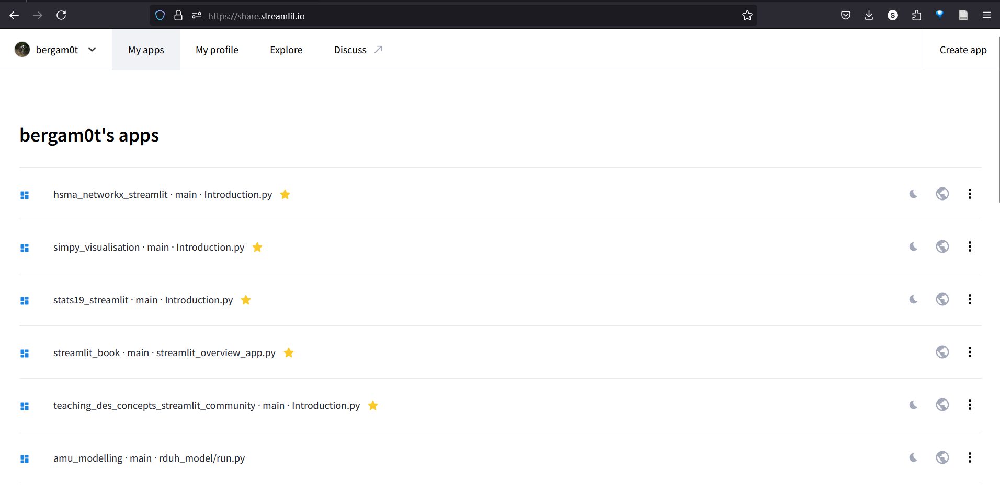{.box}

Clicking on the three dots will allow you to delete or reboot the app, or change various settings relating to app privacy, secrets, and the app URL.

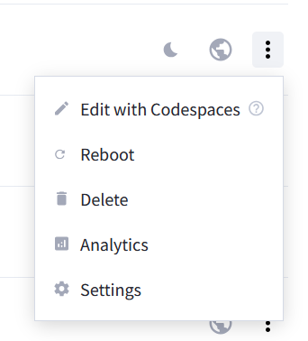{.box}

<br>

## Troubleshooting your app

When loading up your app while logged into your Streamlit community cloud account, you will receive additional powers to manage and troubleshoot your app.

You should see a 'manage app' button at the bottom right of the screen.

{.box}

Clicking on this brings up a sidebar that allows you to see the behind-the-scenes activity that occurs when the virtual machine running your app is first loaded up, along with any logging or error messages. This can give you an idea of why your app isn't working.

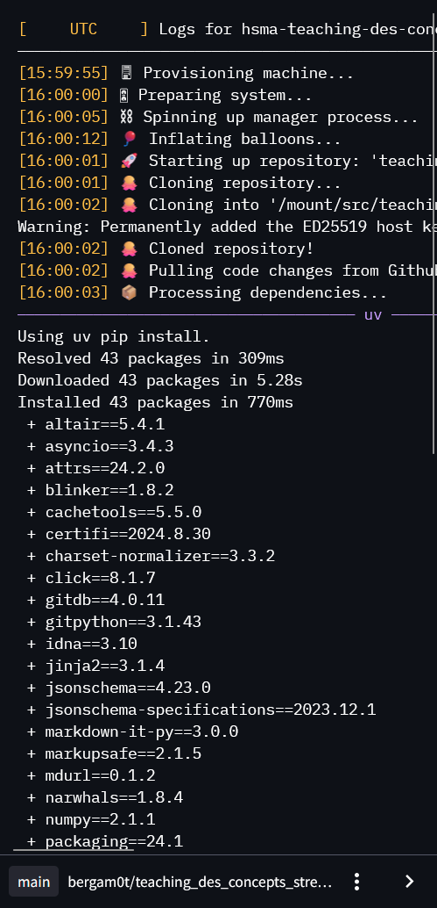{.box}

Clicking on the three dots at the bottom gives you access to some useful commands, like rebooting the app.

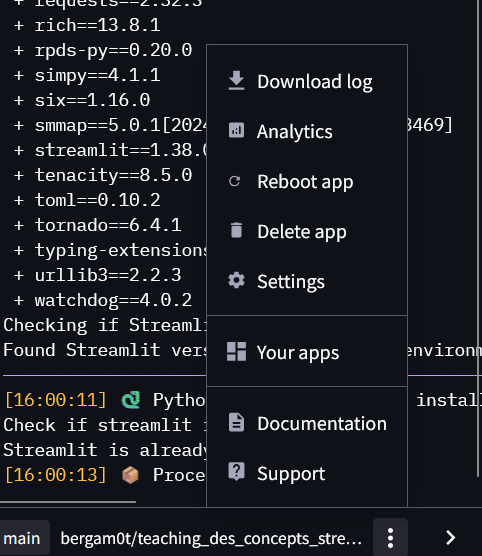{.box}

<br>

## Updating your app

New changes made to your repository should automatically be reflected in your app.

The exception to this may be changes to the list of required packages in `requirements.txt`

If this is the case, you may need to manually reboot the app from the list in <https://share.streamlit.io/> or from within the 'manage app' menu when viewing your app.

{.box}

{.box}

<br>

## Installing packages that aren't on PyPI

### spaCy language models

Most packages can be added to `requirements.txt` by name, as in the example above. Some, like **spaCy language models**, aren't installed that way. Listing `spacy` alone will install the library, but your app will fail when it tries to load a model such as `en_core_web_sm`.

To fix this, add the direct URL of the model's `.whl` file on its own line at the bottom of `requirements.txt`:

```
https://github.com/explosion/spacy-models/releases/download/en_core_web_sm-3.8.0/en_core_web_sm-3.8.0-py3-none-any.whl
```

Paste in just the URL, with nothing else on the line.

:::{.callout-note}
This example is for `en_core_web_sm` version 3.8.0. If you use a different model, you will need the URL for that model and version. You can find them in the [spaCy models documentation](https://spacy.io/models) and on the [spacy-models releases page](https://github.com/explosion/spacy-models/releases).
:::

:::{.callout-tip}
#### Example from a real app
You can see this in practice in the `requirements.txt` of the [PIMS app](https://github.com/hsma-chief-elf/PIMS). There is a lot of conflicting advice online about this problem, but this was the only approach that worked when deploying that app. Thanks to Dan for working it out!
:::

<br>

### Quarto

:::{.callout-warning}
#### Experimental workaround
This approach is **experimental**. It relies on how Streamlit currently sets up the containers that run Community Cloud apps. If Streamlit changes this, the approach may stop working without warning.

It is a workaround rather than an officially supported feature, so don't rely on it for anything critical. We don't believe it breaks Streamlit's terms of service, but check them yourself if you are unsure.
:::

Quarto isn't installed on Community Cloud by default. This matters if you want your app to render a Quarto report, for example to generate an HTML or PDF report from user inputs.

One workaround is to download and install Quarto from inside the app the first time it runs. The example app below does this and then generates a Quarto report. You can see the code for this app at:

<https://github.com/Bergam0t/quarto_streamlit_community_cloud>

```{=html}
<iframe width="100%" height="600" src="https://quarto-community-cloud.streamlit.app/?embed=true" title="Quarto app"></iframe>
```

[Click here to load the app in a new page](https://quarto-community-cloud.streamlit.app/)

**How does it work?** The main app file does the following:

1. It checks whether the app is running on Community Cloud. Here, `platform.processor()` returns an empty string, which the code uses as the signal.
2. If so, it downloads and extracts the Linux build of Quarto.
3. It adds Quarto to the `PATH`, so the app can call it.
4. It installs `jupyter` and a second copy of your `requirements.txt` packages. Quarto can't see the packages installed during Community Cloud's own setup.
5. It runs `quarto check` and prints the output to the logs, so you can see whether the install worked.
6. `@st.cache_data` means the install only happens once, not on every rerun.

```{python}
#| eval: false
import streamlit as st
import os
import subprocess
import platform

@st.cache_data
def get_quarto(repo_name, quarto_version="1.5.57"):
    print(f"Output of platform.processor(): {platform.processor()}")
    print(f"type:  {type(platform.processor())}")
    print("Attempting to download Quarto")
    # Download Quarto
    os.system(f"wget https://github.com/quarto-dev/quarto-cli/releases/download/v{quarto_version}/quarto-{quarto_version}-linux-amd64.tar.gz")

    # Create directory and extract Quarto
    os.system(f"tar -xvzf quarto-{quarto_version}-linux-amd64.tar.gz")
    # Check the contents of the folder we are in
    os.system("pwd")

    # # Ensure PATH is updated in the current Python process
    # Check current path
    os.system("echo $PATH")
    # Create a folder and symlink quarto to that location
    os.system(f"mkdir -p /mount/src/{repo_name}/local/bin")
    os.system(f"ln -s /mount/src/{repo_name}/quarto-{quarto_version}/bin/quarto /mount/src/{repo_name}/local/bin")
    # Update path
    os.system(f"echo 'export PATH=$PATH:/mount/src/{repo_name}/local/bin' >> ~/.bashrc")
    os.system('source /etc/bash.bashrc')
    # alternative method for good measure
    os.environ['PATH'] = f"/mount/src/{repo_name}/local/bin:{os.environ['PATH']}"

    # ensure path updates have propagated through
    print(os.environ['PATH'])
    # Install jupyter even if not in requirements
    os.system("python3 -m pip install jupyter")
    # Install second copy of requirements (so accessible by Quarto - can't access packages
    # that are installed as part of community cloud instance setup process)
    os.system(f"python3 -m pip install -r /mount/src/{repo_name}/requirements.txt")

    print("Trying to run 'quarto check' command")
    try:
        os.system("quarto check")
        result = subprocess.run(['quarto', 'check'], capture_output=True, text=True, shell=True)
        print(result.stdout)
        print(result.stderr)
        print("Quarto check run")
    except PermissionError:
        print("Permission error encountered when running 'quarto check'")
    except:
        print("Other unspecified error when running quarto check")

st.set_page_config(layout="wide")

# If running on community cloud, output of this is an empty string
# If this is the case, we'll try to install quarto
if platform.processor() == '':
    get_quarto("quarto_streamlit_community_cloud") # This name must match the repository name on GitHub

# Set up multipage navigation
pg = st.navigation(

    [st.Page("introduction.py",
             title="App Overview"),
    st.Page("quarto_output_generator_pass.py",
             title="Generate Quarto Report")
     ]
     )

pg.run()
```

Once Quarto is available, the app can render a report with `subprocess`. In this example, the report is created in four steps:

1. The user's inputs are saved to a JSON file (`session_data.json`).
2. The app runs `quarto render` on a `.qmd` template.
3. The template reads the JSON file, so the report reflects the user's inputs.
4. The rendered HTML is offered to the user with `st.download_button`.

```{python}
#| eval: false
import streamlit as st
import json
import os
import subprocess

st.session_state.download_clicked = False

st.title("Passing Parameters to a Quarto Template")

st.write(
    """
In this example, the inputs from the user are saved in a json file and this is then accessed
by quarto when rendering the document.
    """
)

first_number_input = st.slider("Enter a first number", 1, 100)

second_number_input = st.number_input("Enter a second number", value=42)

operation_input = st.selectbox(
    "Select an operation",
    ["Add", "Subtract", "Multiply", "Divide"]
    )

def disable_download():
    st.session_state.download_clicked = True
    report_message.empty()

if st.button("Generate Output"):

    json_path = os.path.join(os.getcwd(), 'session_data.json')
    print(json_path)

    model_parameters = {
        "input_1": first_number_input,
        "input_2": second_number_input,
        "operation": operation_input
    }

    with open(json_path, "w") as f:
        json.dump(model_parameters, f)

    report_message = st.empty()

    report_message.info("Generating Report...")

    ## filepaths for
    output_dir = os.path.join(os.getcwd(),'outputs')
    qmd_filename = 'quarto_calculator_output.qmd'
    qmd_path = os.path.join(os.getcwd(),qmd_filename)
    html_filename = os.path.basename(qmd_filename).replace('.qmd', '.html')
    dest_html_path = os.path.join(output_dir,html_filename)

    try:
        ## forces result to be html
        result = subprocess.run(["quarto"
                                , "render"
                                , qmd_path
                                , "--to"
                                , "html"
                                , "--output-dir"
                                , output_dir]
                                , capture_output=True
                                , text=True)
    except:
        ## error message
        report_message.error(f"Report cannot be generated")

    if os.path.exists(dest_html_path):
        with open(dest_html_path, "r") as f:
            html_data = f.read()

        report_message.success("Report Available for Download")

        if not st.session_state.download_clicked:
            st.download_button(
                label="Download Report",
                data=html_data,
                file_name=html_filename,
                mime="text/html",
                # disabled=not st.session_state.simulation_completed,
                on_click=disable_download
            )
    else:
        ## error message
        report_message.error(f"Report failed to generate\n\n_{result}_")

else:
    ## empty location for report message
    report_message = st.empty()
```
